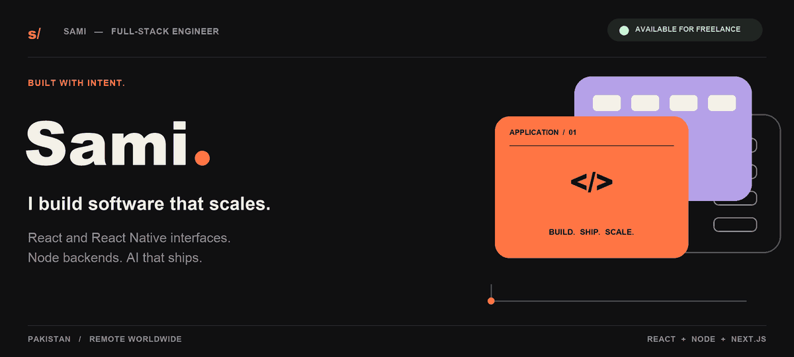
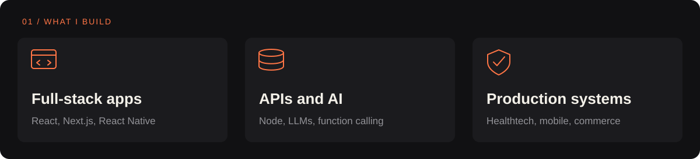
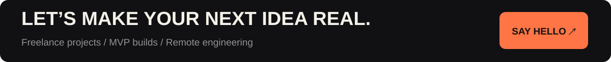

  

<strong>🟢 Available for freelance projects &amp; remote work</strong>

Full-stack engineer at <strong>RipeSeed</strong> · Lahore, Pakistan

  
  
  

 

 

<h2 align="center">The tools behind the work.</h2>

BACKEND &amp; DATA

FRONTEND &amp; INTERFACES

WORKFLOW &amp; TOOLING

  
  
  

 

<h2 align="center">Selected work.</h2>

  <a href="https://ohanadoc.com"><strong>OhanaDoc</strong></a>
  &nbsp; · &nbsp;
  <a href="https://play.google.com/store/apps/details?id=com.spclaims"><strong>SPClaims</strong></a>
  &nbsp; · &nbsp;
  <a href="https://dilkash.vercel.app/"><strong>Dilkash</strong></a>
  &nbsp; · &nbsp;
  <a href="https://github.com/AbdulSamiWaseem/CricSync"><strong>CricSync</strong></a>

HIPAA telehealth · insurance claims · MERN commerce · cricket matchmaking

 

<a href="mailto:abdulsamiwaseem26@gmail.com"><strong>abdulsamiwaseem26@gmail.com</strong></a> &nbsp; · &nbsp; <a href="https://sami-waseem.vercel.app">sami-waseem.vercel.app ↗</a>

